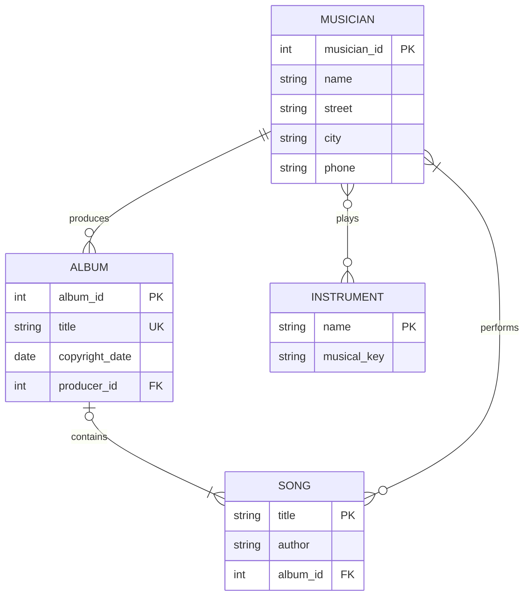

# Part 1: Musicana ERD

An album has one producer and one or more songs. A song belongs to zero or one album (the wording prohibits more than one but does not explicitly require membership). Each song has one or more performers. Each musician may play zero or more instruments; each instrument may be played by zero or more musicians.
Relational mapping: Musician(musician_id PK,name,street,city,phone); Instrument(name PK,musical_key); Album(album_id PK,title UNIQUE,copyright_date,producer_id NOT NULL FK); Song(title PK,author,album_id nullable FK); Plays(musician_id FK,instrument_name FK,composite PK); Performs(musician_id FK,song_title FK,composite PK).
Minimum one performer per song and minimum one song per album require application-level transaction checks or deferred validation; ordinary child foreign keys alone do not enforce these minimum counts.
