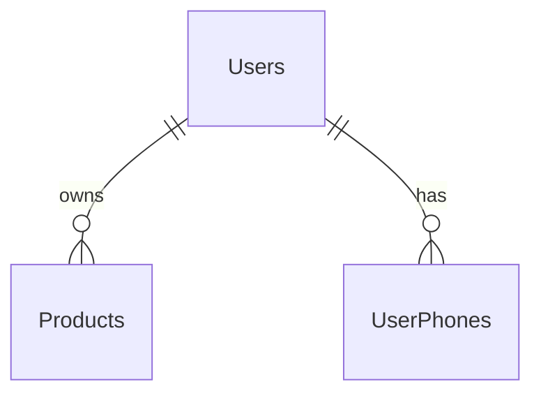

# Part 2: Mapping the supplied User/Product ERD

The diagram shows User with id and email underlined (candidate keys), a composite userName (firstName,lastName), a multivalued phone, and a 1:N ownership relationship to Product.

| Relation   | Columns                                        | Keys                                          |
| ---------- | ---------------------------------------------- | --------------------------------------------- |
| Users      | id, email, firstName, lastName, role, password | id PRIMARY KEY; email UNIQUE NOT NULL         |
| UserPhones | userId, phone                                  | PRIMARY KEY(userId,phone); userId FK Users.id |
| Products   | id, name, stock, price, isDeleted, userId      | id PRIMARY KEY; userId FK Users.id            |

The composite name is decomposed into firstName and lastName. The multivalued phone uses a separate relation. The one-to-many relationship places the owner FK on Products. This mapping is separate from the retail-store tables in Part 3.

